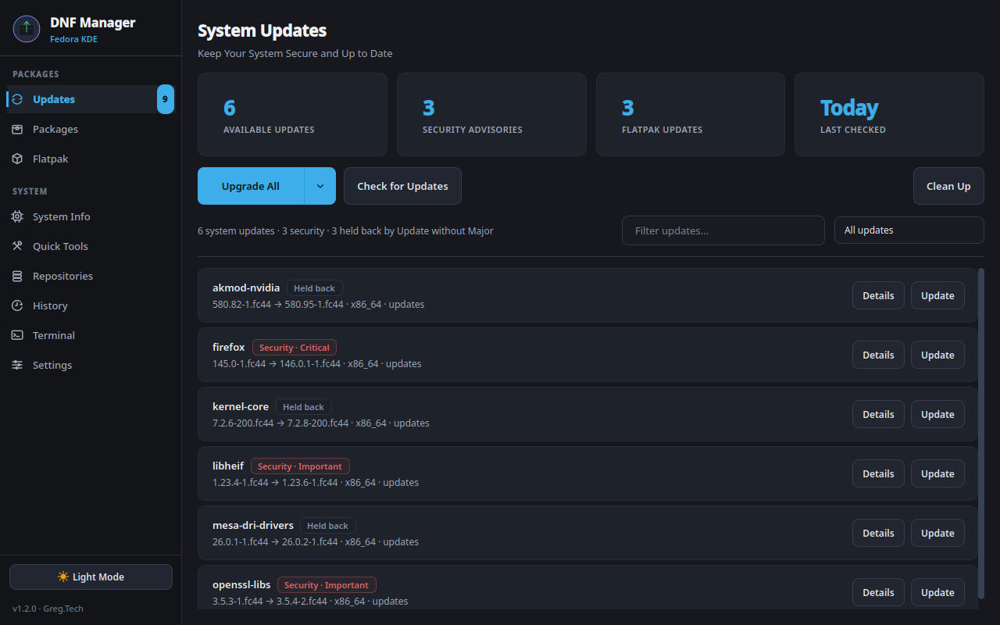
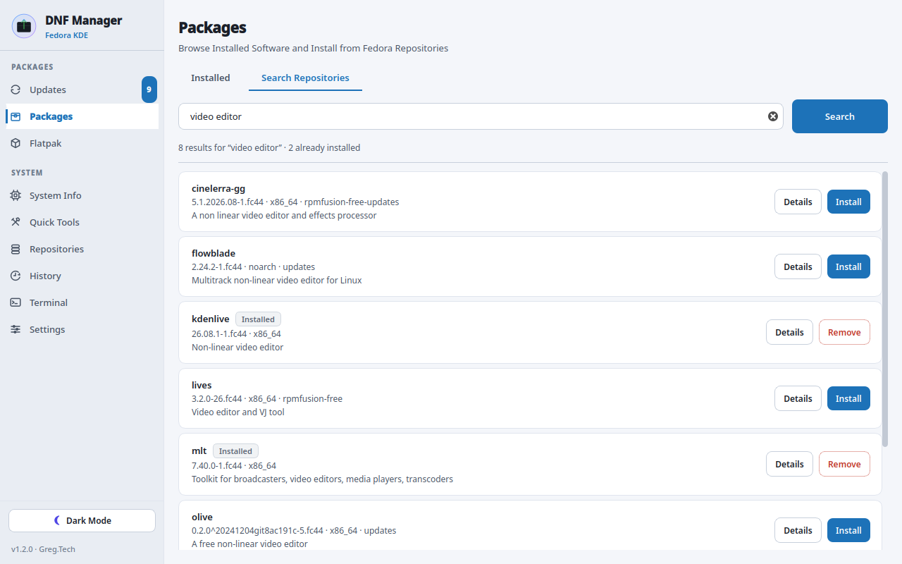

<div align="center">
  
  <h1>DNF Package Manager</h1>
  <p><b>The Discover alternative for Fedora KDE.</b></p>
  <p>Updates you can see, control and trust. Every action runs the real <code>dnf</code> and <code>flatpak</code> commands, with live output.</p>

  <p>
    <a href="https://github.com/grpace/Fedora-DNF-GUI-Tool/releases/latest">
      
    </a>
    
    
    
  </p>

  <p>
    <a href="#install">Install</a> ·
    <a href="docs/switching-from-discover.md">Switch from Discover</a> ·
    <a href="docs/faq.md">FAQ</a> ·
    <a href="CHANGELOG.md">Changelog</a>
  </p>
</div>

<p align="center">
  
  
</p>

---

## Why switch from Discover?

Discover is a good app store. As the tool that keeps a Fedora system updated, it gets in the way:

- **You can't see what it's doing.** Discover works through PackageKit, which hides the package manager behind a progress bar. When something fails you get a summary, not the error.
- **Updates wait for a reboot.** Fedora KDE configures Discover for offline updates (`UseOfflineUpdates=true`), so system updates are installed during a restart, every time.
- **It's all or nothing.** You can untick updates one by one, but there's no "everything except the kernel and graphics drivers" and no "security fixes only".
- **Using it alongside `dnf` duplicates work.** PackageKit keeps its own metadata and package cache in `/var/cache/PackageKit`, separate from dnf's, and it often grows to several gigabytes.

DNF Package Manager does the job the way you would in a terminal, with a proper desktop interface around it:

- **Real commands, live output.** Upgrades run `dnf upgrade` and stream every line into a built-in terminal view. Copy the log with one click.
- **Updates apply now.** No reboot for every update. A banner tells you when a kernel or core library update actually needs a restart.
- **You choose what gets updated.** One button, four modes: everything; everything plus Flatpaks; everything *except* the kernel, drivers, firmware and bootloader; or security fixes only. Star the mode you use most.
- **Discover steps aside cleanly.** One click turns off Discover's update checks so you don't get duplicate notifications, and cancels any update it already scheduled for your next restart. One click brings it all back.

## How it compares

| | DNF Package Manager | Discover on Fedora KDE |
|---|:---:|:---:|
| System updates are installed | Live, like `dnf upgrade`; restart only when needed | Offline, during a restart |
| Shows the commands it runs and their output | ✅ | ❌ progress bar only |
| Talks to | `dnf5` / `dnf` directly | PackageKit (separate daemon and cache) |
| Skip kernel, graphics driver, firmware and bootloader updates | ✅ one click, configurable | ❌ untick each update, every time |
| Security-only updates | ✅ | ❌ |
| DNF transaction history with undo | ✅ | ❌ |
| Fedora release upgrades (e.g. 44 → 45) | ✅ | ✅ |
| Search and install RPMs | ✅ | ✅ |
| Flatpak apps and Flathub | ✅ | ✅ |
| Firmware updates (fwupd) | ✅ | ✅ |
| Update reminders | ✅ notification at login | ✅ |
| Automatic unattended updates | ❌ reminders only | ✅ |
| Curated app catalog with screenshots, ratings and reviews | ❌ | ✅ |
| KDE add-ons (widgets, themes) | ❌ | ✅ |

**You can use both.** Plenty of people keep Discover for browsing apps and Plasma add-ons and let DNF Package Manager handle updates. The takeover only turns off Discover's *update* checks; installing apps from Discover keeps working. See [Switching from Discover](docs/switching-from-discover.md).

---

## Features

### Updates
- **One update button, your choice of mode.** The dropdown explains each mode and shows exactly what it would install. Star a mode to make it the main button; `Ctrl+U` runs it from anywhere.
  - **Upgrade All:** `dnf upgrade --refresh`.
  - **Update Everything:** system packages, then all Flatpak apps, in one session.
  - **Update without Major:** everything except core packages (`kernel*`, `linux-firmware*`, `*-gpu-firmware`, `*nvidia*`, `akmod-*`, `mesa-*`, `grub2-*`, `shim-*`), via `dnf upgrade --exclude=…`.
  - **Security Only:** `dnf upgrade --security`.
- **A list that tells you something.** Each row shows the installed and new version (`145.0 → 146.0.1`), tags security fixes with their severity, and tags **Major** updates (the ones Update without Major skips). Filter by name, or show only security or major updates.
- **Decide what counts as major:** **Mark Major** / **Unmark Major** on any row, or edit the patterns in Settings.
- **Previews before you confirm:** package count and download size for every upgrade.
- **Reboot banner** only when a kernel or core library update needs it.
- **Fedora release upgrades.** When a new Fedora release is out (betas are never offered), a banner shows how long your current release keeps getting updates. It then walks you through Fedora's documented `dnf system-upgrade` flow: update, download the new release while you keep working, and restart only when you say so.

### Packages and Flatpaks
- **Search the repositories** (Fedora, RPM Fusion, your COPRs) by name or description. Results show the version, the source repository and whether a package is already installed.
- **Installed packages:** filter, sort, inspect and remove.
- **Clean Up** lists exactly what `dnf autoremove` would remove before you confirm.
- **Flatpak manager:** search Flathub, install, update, remove, prune unused runtimes, repair.

### System
- **System information:** OS, kernel, desktop, CPU, GPU, memory and storage at a glance.
- **Quick Tools:** enable RPM Fusion and Flathub, firmware updates via `fwupdmgr`, clean or rebuild the DNF cache, distribution sync.
- **Repositories:** enable or disable repos and add COPRs.
- **History:** every DNF transaction, with undo.

### Settings
- **Discover takeover** for your account, or for every account on the computer. Fully reversible. If Discover already scheduled updates for your next restart, the app tells you and can cancel them (`pkcon offline-cancel`), so PackageKit doesn't install a stale update set when you reboot.
- **Update reminders:** a login check with a desktop notification, optionally only for security updates.
- **Passwordless updates (optional):** a validated sudoers rule that lets the app's exact upgrade commands run without a password prompt, while installs and removals still ask. See [Security model](#security-model).

### Desktop
- **Light and dark themes** in the Breeze style, with colors that meet WCAG AA contrast.
- **Completion notifications** when a long operation finishes while you're in another window.

---

## Install

**Requirements:** Fedora 40 or newer, Python 3.12+, `python3-pyqt6` and polkit. Built for KDE Plasma; it runs on any Fedora desktop, but the Discover takeover only matters on Plasma. Optional: `flatpak`, `fwupd`, `libnotify`. Fedora Atomic desktops (Kinoite, Silverblue) use rpm-ostree and aren't supported.

### RPM (recommended)

Download the latest `DNF-Package-Manager-vX.Y.Z.rpm` from [Releases](https://github.com/grpace/Fedora-DNF-GUI-Tool/releases/latest) and install it with DNF so dependencies are resolved:

```bash
sudo dnf install ~/Downloads/DNF-Package-Manager-*.rpm
```

### From source

```bash
git clone https://github.com/grpace/Fedora-DNF-GUI-Tool.git
cd Fedora-DNF-GUI-Tool
sudo ./install.sh            # installs to /opt/dnf-gui with a dnf-gui launcher
```

Or run it without installing: `PYTHONPATH=src python3 -m dnf_gui`

### First run

1. Open **DNF Package Manager** from the application menu (System), or run `dnf-gui`.
2. Go to **Settings → Discover Update Checks** and click **Use This App Instead**.
3. Turn on **Update Reminders** if you want a notification when updates are waiting.

The full walkthrough, including how to undo it, is in [Switching from Discover](docs/switching-from-discover.md).

---

## Keyboard shortcuts

| Shortcut | Action |
|---|---|
| `Ctrl+U` | Run your main update option |
| `Ctrl+R` | Refresh the current page |
| `Ctrl+F` | Focus the search or filter field |
| `Ctrl+T` | Open the live terminal |
| `Ctrl+1` … `Ctrl+9` | Switch pages |

## Command line

```bash
dnf-gui                                 # open the app
dnf-gui --check                         # headless update check (used by the login reminder)
dnf-gui --check --security-only         # only notify about security updates, this run only
DNF_GUI_FORCE_CHECK=1 dnf-gui --check   # ignore the reminder interval
```

`--check` exits with `0` when nothing needs attention and `2` when updates are pending.

---

## Security model

- **Read-only work runs as you.** Update checks, searches, package details, history and system information need no privileges.
- **Changes go through polkit.** Installs, removals, upgrades and repository changes run via `pkexec`, which shows the standard desktop password dialog.
- **No shell interpolation.** Commands run as argument lists. The few fixed shell scripts (the firmware check, the sudoers installer and the Discover takeover) never contain user input.
- **Passwordless updates are exact-match.** The optional rule in `/etc/sudoers.d/90-dnf-gui` lists only the exact command lines for Upgrade All, Security Only and Update without Major, with no wildcards. It's checked with `visudo` before and after installation. An "All DNF operations" scope exists for single-user machines; it removes every prompt, so any program running as you could change system packages.
- **Verified self-updates.** App updates download only from GitHub and are checked against the SHA-256 digest GitHub publishes for the release before DNF installs them.

---

## Uninstall

```bash
sudo dnf remove dnf-gui        # RPM install
sudo ./install.sh remove       # source install
```

Before uninstalling, click **Restore Discover** in Settings, plus **Turn Back On** if you used the all-users option. If you enabled passwordless updates, disable them too, or delete `/etc/sudoers.d/90-dnf-gui`.

---

## Contributing

Bug reports and pull requests are welcome on [GitHub](https://github.com/grpace/Fedora-DNF-GUI-Tool/issues).

```bash
pip install pytest ruff                      # or: sudo dnf install python3-pytest ruff
QT_QPA_PLATFORM=offscreen pytest             # tests need no network, root or real config
ruff check src tests scripts                 # lint
PYTHONPATH=src python3 scripts/check_contrast.py   # WCAG contrast check, both themes
```

```
src/dnf_gui/
  core/       dnf, Flatpak, security, release upgrades, settings, workers (no UI)
  ui/         main window, sidebar, pages/, widgets/, styles/theme.py
packaging/    RPM spec and AppStream metadata
assets/       icon and desktop entry
docs/         guides and screenshots
tests/        pytest suite
```

Maintainers: see [RELEASING.md](RELEASING.md).

## License

Copyright © 2026 Greg.Tech. Licensed under the GNU General Public License v3.0 or later. See [LICENSE](LICENSE).
