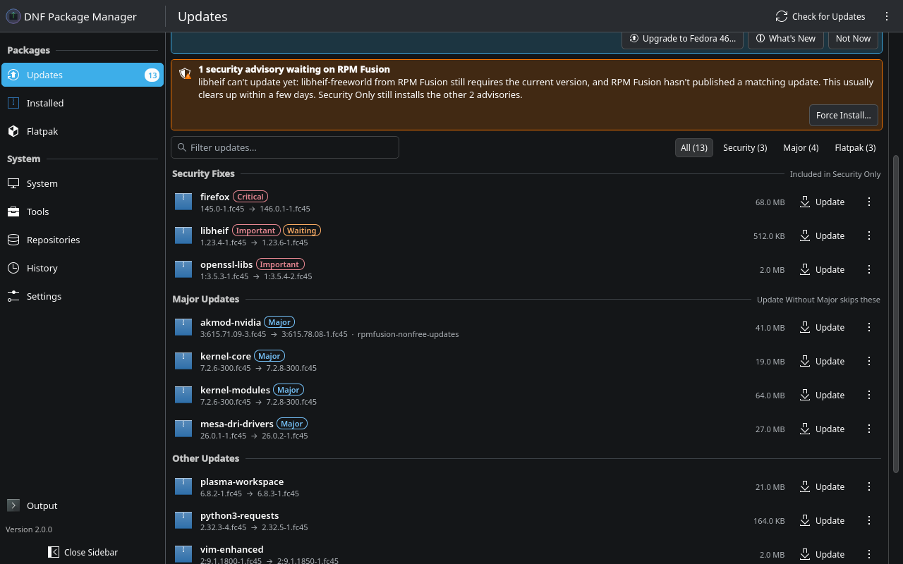
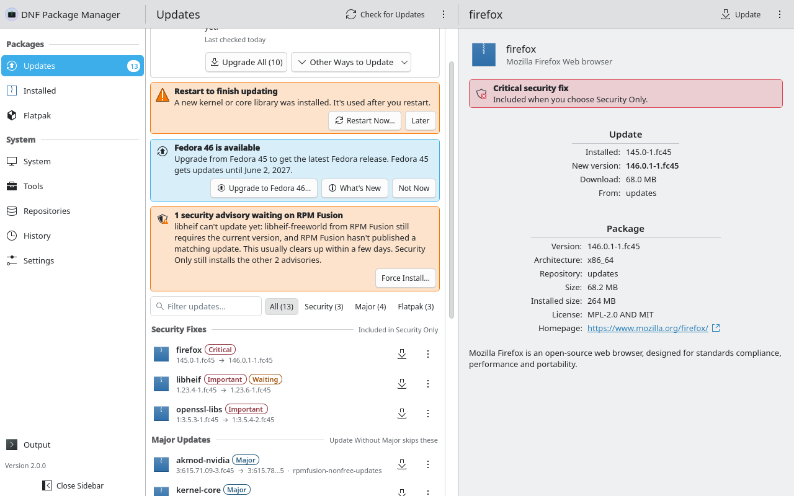

<div align="center">
  
  <h1>DNF Package Manager</h1>
  <p><b>The Discover alternative for Fedora KDE.</b></p>
  <p>Updates you can see, control and trust. Every action runs the real <code>dnf</code> and <code>flatpak</code> commands, with live output.</p>

  <p>
    <a href="https://github.com/grpace/Fedora-DNF-GUI-Tool/releases/latest">
      
    </a>
    
    
    
  </p>

  <p>
    <a href="#install">Install</a> ·
    <a href="docs/switching-from-discover.md">Switch from Discover</a> ·
    <a href="docs/faq.md">FAQ</a> ·
    <a href="CHANGELOG.md">Changelog</a>
  </p>
</div>

<p align="center">
  
  
</p>

---

## Why switch from Discover?

Discover is a good app store. As the tool that keeps a Fedora system updated, it gets in the way:

- **You can't see what it's doing.** Discover works through PackageKit, which hides the package manager behind a progress bar. When something fails you get a summary, not the error.
- **Updates wait for a reboot.** Fedora KDE configures Discover for offline updates (`UseOfflineUpdates=true`), so system updates are installed during a restart, every time.
- **It's all or nothing.** You can untick updates one by one, but there's no "everything except the kernel and graphics drivers" and no "security fixes only".
- **Using it alongside `dnf` duplicates work.** PackageKit keeps its own metadata and package cache in `/var/cache/PackageKit`, separate from dnf's, and it often grows to several gigabytes.

DNF Package Manager does the job the way you would in a terminal, with a proper desktop interface around it:

- **Real commands, live output.** Upgrades run `dnf upgrade`. A small status capsule floats over every page with the current step and a progress ring, and opens into the full live output. Copy the log with one click.
- **Updates apply now.** No reboot for every update. A notice tells you when a kernel or core library update actually needs a restart.
- **You choose what gets updated.** One button, four modes: everything; everything plus Flatpaks; everything *except* the kernel, drivers, firmware and bootloader; or security fixes only. Star the mode you use most.
- **Discover steps aside cleanly.** One click turns off Discover's update checks so you don't get duplicate notifications, and cancels any update it already scheduled for your next restart. One click brings it all back.

## How it compares

| | DNF Package Manager | Discover on Fedora KDE |
|---|:---:|:---:|
| System updates are installed | Live, like `dnf upgrade`; restart only when needed | Offline, during a restart |
| Shows the commands it runs and their output | ✅ | ❌ progress bar only |
| Talks to | `dnf5` / `dnf` directly | PackageKit (separate daemon and cache) |
| Skip kernel, graphics driver, firmware and bootloader updates | ✅ one click, configurable | ❌ untick each update, every time |
| Security-only updates | ✅ | ❌ |
| DNF transaction history with undo | ✅ | ❌ |
| Fedora release upgrades (e.g. 44 → 45) | ✅ | ✅ |
| Search and install RPMs | ✅ | ✅ |
| Flatpak apps and Flathub | ✅ | ✅ |
| Firmware updates (fwupd) | ✅ | ✅ |
| Update reminders | ✅ on your schedule; click to open Updates | ✅ |
| Automatic unattended updates | ❌ reminders only | ✅ |
| Curated app catalog with screenshots, ratings and reviews | ❌ | ✅ |
| KDE add-ons (widgets, themes) | ❌ | ✅ |

**You can use both.** Plenty of people keep Discover for browsing apps and Plasma add-ons and let DNF Package Manager handle updates. The takeover only turns off Discover's *update* checks; installing apps from Discover keeps working. See [Switching from Discover](docs/switching-from-discover.md).

---

## Features

### Updates
- **One clear status, one main button.** The Updates page says what's waiting and why it matters ("3 security advisories, 1 critical"), or that you're up to date and when it last checked. Never "up to date" when the check failed. The main button runs your chosen mode, with its count; **Other Ways to Update** lists the rest and what each would install. `Ctrl+U` runs the main one from anywhere.
  - **Upgrade All:** `dnf upgrade --refresh`.
  - **Update Everything:** system packages, then all Flatpak apps, in one session.
  - **Update Without Core:** everything except core packages (`kernel*`, `linux-firmware*`, `*-gpu-firmware`, `*nvidia*`, `akmod-*`, `mesa-*`, `grub2-*`, `shim-*`), via `dnf upgrade --exclude=…`.
  - **Security Only:** `dnf upgrade --security`.
- **A list that tells you something.** Updates are grouped into Security Fixes, Core Updates, Other Updates and Flatpak Apps. Each row shows the installed and new version (`145.0 → 146.0.1`), the download size, the severity of security fixes, and a **Core** tag for updates Update Without Core skips. Filter by name, or by All, Security, Core or Flatpak.
- **Update one thing at a time:** every row, Flatpak apps included, has its own **Update** button.
- **Details beside the list:** click an update for its security status, versions and `dnf info`, in a column next to the list. Drag the divider to give the list more room; the width is remembered.
- **Decide what counts as core:** **Treat as Core** on any row's menu, or edit the patterns in Settings.
- **Previews before you confirm:** package count and download size for every upgrade.
- **Compact notices** for what needs attention: a restart that's actually needed, a new Fedora release, an app update, or a security fix waiting on another repository. One line each; expand one for the full text.
- **Fedora release upgrades.** When a new Fedora release is out (betas are never offered), a notice shows how long your current release keeps getting updates. It then walks you through Fedora's documented `dnf system-upgrade` flow: update, download the new release while you keep working, and restart only when you say so.

### Packages and Flatpaks
- **Search the repositories** (Fedora, RPM Fusion, your COPRs) by name or description. Results show the version, the source repository and whether a package is already installed.
- **Installed packages:** filter instantly, sort, open details beside the list, and remove.
- **Clean Up** lists exactly what `dnf autoremove` would remove before you confirm.
- **Flatpak manager:** search Flathub, install, update, remove, prune unused runtimes, repair.

### System
- **System information:** your device and firmware, Fedora and Plasma versions, kernel, CPU, GPU, memory, storage (with the filesystem), battery, SELinux and Secure Boot, and when the system was last updated.
- **Tools:** enable RPM Fusion and Flathub, firmware updates via `fwupdmgr`, clean or rebuild the DNF cache, distribution sync.
- **Repositories:** enable or disable repos and add COPRs.
- **History:** every DNF transaction, with what it changed beside the list and undo.

### Settings
- **Discover takeover** for your account, or for every account on the computer. Fully reversible. If Discover already scheduled updates for your next restart, the app tells you and can cancel them (`pkcon offline-cancel`), so PackageKit doesn't install a stale update set when you reboot.
- **Update reminders** on your chosen schedule, even while the app is closed, optionally only for security updates. Click a reminder (or its **View Updates** button) to open the Updates page with a fresh scan.
- **Passwordless updates (optional):** a validated sudoers rule that lets the app's exact upgrade commands run without a password prompt, while installs and removals still ask. See [Security model](#security-model).

### Desktop
- **Native KDE Plasma interface** (Kirigami). It follows your color scheme, accent, fonts and light or dark setting; the colors it adds meet WCAG AA contrast in Breeze Light and Dark. Works with the keyboard and screen readers, and the sidebar folds to icons on narrow windows (or with the toggle at its top).
- **Its own title bar.** A rounded window whose sidebar runs to the top; the page header is the title bar: drag it to move the window, double-click to maximize, with minimize, maximize and close in the top-right corner.
- **Clear icons.** A consistent bold icon set, and package rows show the app's own icon (from Fedora's AppStream data) or a colored letter tile.
- **Completion notifications** when a long operation finishes while you're in another window. Click one to return to the app; if the operation failed, **Show Output** opens its output.
- **One window.** Opening the app while it's already running brings the existing window forward.
- **Close during an update.** If you close the window while dnf is running, the operation finishes in the background and you get a notification. A failure brings the window back with the output.

---

## Install

**Requirements:** Fedora 40 or newer, Python 3.12+, `python3-pyqt6`, KDE's Kirigami (`kf6-kirigami`, `kf6-kirigami-addons`, `kf6-qqc2-desktop-style`) and polkit; the RPM and `install.sh` pull these in. Built for KDE Plasma; it runs on any Fedora desktop, but the Discover takeover only matters on Plasma. Optional: `flatpak`, `fwupd`, `libnotify`. Fedora Atomic desktops (Kinoite, Silverblue) use rpm-ostree and aren't supported.

### RPM (recommended)

Download the latest `DNF-Package-Manager-vX.Y.Z.rpm` from [Releases](https://github.com/grpace/Fedora-DNF-GUI-Tool/releases/latest) and install it with DNF so dependencies are resolved:

```bash
sudo dnf install ~/Downloads/DNF-Package-Manager-*.rpm
```

### From source

```bash
git clone https://github.com/grpace/Fedora-DNF-GUI-Tool.git
cd Fedora-DNF-GUI-Tool
sudo ./install.sh            # installs to /opt/dnf-gui with a dnf-gui launcher
```

Or run it without installing: `PYTHONPATH=src python3 -m dnf_gui`

### First run

1. Open **DNF Package Manager** from the application menu (System), or run `dnf-gui`.
2. Go to **Settings → KDE Discover** and click **Use This App for Updates…**.
3. Turn on **Settings → Reminders** if you want a notification when updates are waiting.

The full walkthrough, including how to undo it, is in [Switching from Discover](docs/switching-from-discover.md).

---

## Keyboard shortcuts

| Shortcut | Action |
|---|---|
| `Ctrl+U` | Run your main update option |
| `Ctrl+R` | Refresh the current page |
| `Ctrl+F` | Focus the search or filter field |
| `Ctrl+T` | Show or hide the output |
| `Ctrl+1` … `Ctrl+9` | Switch pages |

## Command line

```bash
dnf-gui                                 # open the app (or bring the open window forward)
dnf-gui --page updates                  # open on a page: updates, installed, flatpak, sysinfo,
                                        #   tools, repos, history, terminal or settings
dnf-gui --check                         # headless update check
dnf-gui --check --wait                  # ...and stay until the reminder is clicked (what the timer runs)
dnf-gui --check --security-only         # only notify about security updates, this run only
DNF_GUI_FORCE_CHECK=1 dnf-gui --check   # ignore the reminder interval
```

`--check` exits with `0` when nothing needs attention (or no check is due), `2` when updates are pending, and `1` when it couldn't check or deliver the notification (the reminder timer retries on `1`). Without `--wait`, the reminder has no buttons, because nothing is left running to answer a click.

---

## Security model

- **Read-only work runs as you.** Update checks, searches, package details, history and system information need no privileges.
- **Changes go through polkit.** Installs, removals, upgrades and repository changes run via `pkexec`, which shows the standard desktop password dialog.
- **No shell interpolation.** Commands run as argument lists. The few fixed shell scripts (the firmware check, the sudoers installer and the Discover takeover) never contain user input.
- **Passwordless updates are exact-match.** The optional rule in `/etc/sudoers.d/90-dnf-gui` lists only the exact command lines for Upgrade All, Security Only and Update Without Core, with no wildcards. It's written to a temporary file, checked with `visudo`, and only then moved into place, and your login name comes from your account entry, not the environment. An "All DNF operations" scope exists for single-user machines; it removes every prompt, so any program running as you could change system packages.
- **System programs only.** Privileged commands run `dnf`, `flatpak`, `sudo` and `visudo` from `/usr/bin` and the other system directories, never from `$PATH` (Fedora puts the user-writable `~/.local/bin` first). The launcher and menu entry use absolute paths too.
- **Verified self-updates.** App updates download only from GitHub and are offered only when GitHub published a SHA-256 digest for the file. After you approve, a root step copies the download somewhere only root can write, checks that copy against the digest again, and installs exactly that copy, so nothing running as you can swap the file while the password prompt is open.

---

## Uninstall

```bash
sudo dnf remove dnf-gui        # RPM install
sudo ./install.sh remove       # source install
```

Before uninstalling, click **Restore Discover** in Settings, plus **Turn Back On** if you used the all-users option. If you enabled passwordless updates, disable them too, or delete `/etc/sudoers.d/90-dnf-gui`.

---

## Contributing

Bug reports and pull requests are welcome on [GitHub](https://github.com/grpace/Fedora-DNF-GUI-Tool/issues).

```bash
sudo dnf install python3-pytest ruff         # plus the Requirements above
QT_QPA_PLATFORM=offscreen pytest             # tests need no network, root or real config
ruff check src tests scripts                 # lint
python3 scripts/check_contrast.py            # WCAG contrast of the app's colors, Breeze Light/Dark
PYTHONPATH=src python3 scripts/screenshots.py /tmp/shots --demo --strict   # every page, both themes
```

```
src/dnf_gui/
  core/       dnf, Flatpak, security, release upgrades, settings, workers (no UI)
  ui/         controllers/ (Python state and actions for QML), qml/ (Kirigami pages),
              icons/ (bundled Phosphor icons), iconset.py (draws them in the theme's colors)
packaging/    RPM spec and AppStream metadata
assets/       desktop entry
docs/         guides and screenshots
tests/        pytest suite
```

Maintainers: see [RELEASING.md](RELEASING.md).

## License

Copyright © 2026 Greg.Tech. Licensed under the GNU General Public License v3.0 or later. See [LICENSE](LICENSE).

The interface icons are from [Phosphor Icons](https://phosphoricons.com) (MIT License, see [src/dnf_gui/ui/icons/LICENSE](src/dnf_gui/ui/icons/LICENSE)).
