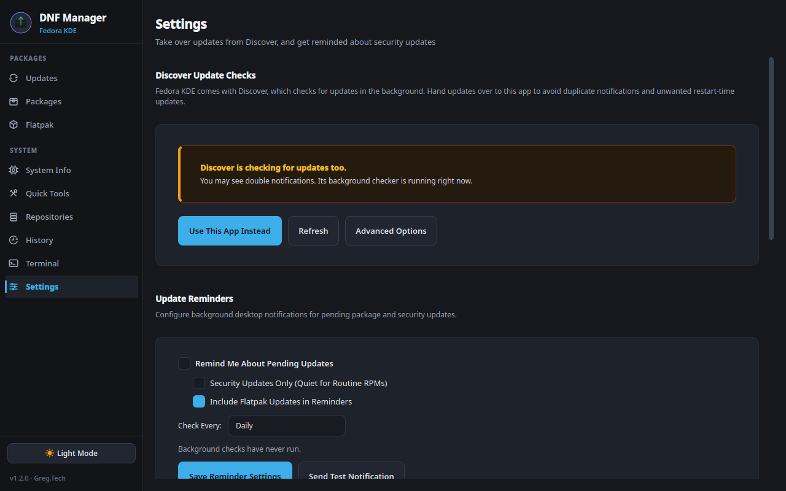

# Switching from Discover

This guide moves update duty from KDE Discover to DNF Package Manager on Fedora KDE. It takes about five minutes, and every step can be undone.

You don't have to uninstall Discover. Most people keep it for browsing apps and Plasma add-ons; this only turns off its *update* checks so the two apps don't both nag you about the same updates.

<p align="center"></p>

## 1. Install DNF Package Manager

Download the latest RPM from [Releases](https://github.com/grpace/Fedora-DNF-GUI-Tool/releases/latest) and install it:

```bash
sudo dnf install ~/Downloads/DNF-Package-Manager-*.rpm
```

Open it from the application menu (**System → DNF Package Manager**) or run `dnf-gui`.

## 2. Turn off Discover's update checks

Go to **Settings → Discover Update Checks** and click **Use This App Instead**. This is per-user and needs no password. It:

- hides Discover's background update checker for your account (a `Hidden=true` override in `~/.config/autostart/org.kde.discover.notifier.desktop`), and
- sets Discover's own update notifications to "never" (`~/.config/PlasmaDiscoverUpdates`).

The checker that's already running stops at your next login. Click **Advanced Options → Stop Checker Now** to stop it immediately.

### If Discover already scheduled an update

Discover on Fedora KDE installs system updates during a restart. If it has already scheduled one, the takeover offers to cancel it, and the Settings card shows **Cancel Restart Update** until it's gone. Cancelling is the better choice: otherwise PackageKit installs its own, possibly out-of-date, set of updates at your next restart, even after this app has updated those packages. Nothing is uninstalled; the downloaded packages simply stay in PackageKit's cache.

From a terminal, the same thing is:

```bash
pkcon offline-get-prepared    # "No offline updates have been prepared" means there's nothing scheduled
pkcon offline-cancel          # unschedule it
```

### For every account on this computer (optional)

**Advanced Options → Turn Off for All Users** asks for an administrator password and:

- masks the checker's systemd unit for all users (`systemctl --global mask app-org.kde.discover.notifier@autostart.service`),
- silences Discover's update notifications by default in `/etc/xdg/PlasmaDiscoverUpdates`, leaving any file an administrator already put there alone, and
- cancels any restart-time update Discover already scheduled (`pkcon offline-cancel`), then stops PackageKit from installing updates during restarts (`systemctl mask packagekit-offline-update.service`).

These changes survive Discover package updates. PackageKit itself keeps running, so installing apps from Discover still works. Fedora release upgrades started from DNF Package Manager use dnf's own offline mechanism and aren't affected.

**Advanced Options → Uninstall Checker** goes further and removes the `plasma-discover-notifier` package while keeping Discover itself.

## 3. Set up reminders

Under **Settings → Update Reminders**, turn on **Remind Me About Pending Updates** and choose how often to check. A small login check (`dnf-gui --check`) then sends a desktop notification when updates are waiting, without keeping anything running in the background.

- **Security Updates Only** keeps quiet about routine updates and only notifies you about security fixes.
- **Include Flatpak Updates** notifies you about Flatpak updates either way.

Click **Send Test Notification** to see what it looks like.

## 4. Pick your update style

On the **Updates** page, the main button runs your favorite update mode. Open the arrow next to it to see all four, each with what it would install right now:

| Mode | Runs | Good for |
|---|---|---|
| Upgrade All | `dnf upgrade --refresh` | Keeping everything current |
| Update Everything | `dnf upgrade`, then `flatpak update` | One click for system and apps |
| Update without Major | `dnf upgrade --exclude=kernel*,*nvidia*,mesa-*,…` | Day-to-day updates that won't touch the kernel or graphics stack |
| Security Only | `dnf upgrade --security` | Getting fixes fast with minimal change |

Click the star next to a mode to make it the main button. `Ctrl+U` runs it from any page.

Rows tagged **Major** are the updates Update without Major skips: by default the kernel, firmware, graphics drivers and bootloader. Hover over the tag to see why a package counts as major. To have Update without Major skip something else as well, click **Mark Major** on its row (**Unmark Major** undoes it). The default patterns are editable under **Settings → Update without Major**.

> "Major" doesn't mean "never updated". Upgrade All and Update Everything install major updates too, and kernel updates include security fixes, so run **Upgrade All** regularly.

## 5. Optional: stop the password prompts

**Settings → Password Prompts → Enable Passwordless** with **Updates Only** installs a sudoers rule covering exactly three commands: Upgrade All, Security Only and Update without Major. Installs, removals, repository changes and firmware updates still ask for a password. The rule names the exact Update without Major command, so after you change which packages count as major, Settings tells you to click **Enable Passwordless** once more.

## Optional: reclaim PackageKit's cache

PackageKit keeps its own copy of repository metadata and downloaded packages, separate from dnf's, and it's often several gigabytes. Once DNF Package Manager handles updates you can clear it:

```bash
du -sh /var/cache/PackageKit                      # see how much space it uses
sudo systemctl stop packagekit
sudo rm -rf /var/cache/PackageKit/*
```

It's only a cache. Discover rebuilds what it needs the next time you open it.

## Going back to Discover

1. **Settings → Discover Update Checks → Restore Discover** undoes the per-user takeover.
2. If you used **Turn Off for All Users**, click **Advanced Options → Turn Back On**. This unmasks everything and restores the checker's autostart entry if an older version of this app removed it.
3. If you used **Uninstall Checker**, reinstall it: `sudo dnf install plasma-discover-notifier`.
4. Turn off **Update Reminders** so you don't get two sets of notifications.

Then log out and back in.
